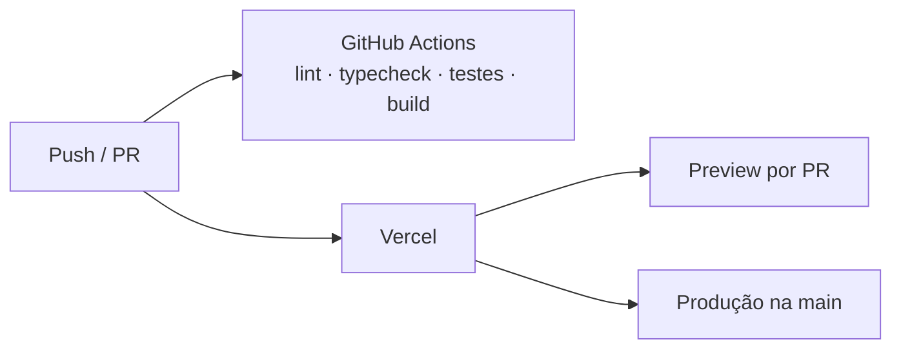

<div align="center">


# RateMedia

**Acompanhe, avalie e resenhe animes, mangás, séries e filmes — e descubra campanhas de RPG criadas pela comunidade.**

[](https://github.com/LuisGlauser/RateMedia/actions/workflows/ci.yml)


[Documentação](#-documentação) · [Funcionalidades](#-funcionalidades) · [Como rodar](#-como-rodar) · [Arquitetura](#-arquitetura) · [Contribuindo](CONTRIBUTING.md) · [Wiki](https://github.com/LuisGlauser/RateMedia/wiki)

</div>

---

## 📌 Sobre

O **RateMedia** é uma aplicação web no estilo *Letterboxd* que reúne em um só lugar o acompanhamento de **animes, mangás, séries e filmes**. O diferencial é o módulo de **campanhas de RPG de mesa**, que são criadas, divulgadas e avaliadas pela própria comunidade.

Projeto final da disciplina de **DevOps (Fatec)**, com integração contínua no GitHub Actions, deploy contínuo na Vercel, imagem Docker e segurança por *Row Level Security* no PostgreSQL.

## ✨ Funcionalidades

| Módulo | O que faz |
| --- | --- |
| 🔎 **Busca avançada** | Texto, tipo, faixa de nota, gêneros, 4 ordenações e paginação. |
| 🎬 **Página da obra** | Sinopse, metadados, média da comunidade e críticas com proteção de *spoiler*. |
| 📚 **Biblioteca pessoal** | Status (quero ver/ler, vendo/lendo, concluído, abandonado), progresso e nota de 1 a 10. |
| 🗂️ **Listas** | Listas públicas ou privadas; adicionar obras direto da página da obra. |
| 👤 **Perfil** | Bio, localização, avatar e banner. |
| 🎲 **Campanhas de RPG** | Criar, editar, avaliar e descobrir mesas (D&D, Tormenta20, Call of Cthulhu…). |
| 🛡️ **Painel admin** | Métricas, CRUD do catálogo, importação do AniList/Jikan/TMDB, moderação e papéis. |
| 📖 **Central de documentação** | `/docs` com Markdown, diagramas UML/DER, Word e PDF. |

<details>
<summary><b>📸 Capturas de tela</b></summary>

| Busca | Campanhas |
| --- | --- |
|  |  |
| **Documentação** | **Diagramas** |
|  |  |

</details>

## 🧰 Stack

| Camada | Tecnologias |
| --- | --- |
| Front-end | Next.js 15 (App Router, Server Components), React 19, Tailwind CSS, lucide-react |
| Back-end | Server Actions do Next.js |
| Dados e autenticação | Supabase (PostgreSQL + Auth e-mail/senha + RLS) |
| Integrações | AniList (GraphQL), Jikan v4 (MyAnimeList), TMDB v3 |
| Qualidade | TypeScript, ESLint, Vitest |
| DevOps | GitHub Actions, Vercel, Docker / Docker Compose |

## 📖 Documentação

A documentação completa fica no próprio site, em **`/docs`**, e no repositório em [`public/docs`](public/docs):

| Formato | Conteúdo |
| --- | --- |
| [Markdown](public/docs/md/README.md) | 11 capítulos: visão geral, requisitos, casos de uso, histórias de usuário, arquitetura, modelo de dados, classes, sequência, integrações, DevOps e testes. |
| [Diagramas](public/docs/diagramas) | Casos de uso, classes, DER, 6 sequências, 2 estados, arquitetura, implantação e navegação (fontes Mermaid em `src/`). |
| [Word](public/docs/word/RateMedia-Documentacao.docx) | Documento completo e editável. |
| [PDF](public/docs/pdf/RateMedia-Documentacao.pdf) | Versão para leitura e impressão. |

Guias rápidos estão na [Wiki](https://github.com/LuisGlauser/RateMedia/wiki) (fonte em [`wiki/`](wiki)).

## 🚀 Como rodar

### Pré-requisitos

- Node.js 22+ e npm
- Uma conta gratuita no [Supabase](https://supabase.com) (opcional: sem ela o site usa dados de demonstração)
- Chave do [TMDB](https://www.themoviedb.org/settings/api) (opcional, para filmes e séries)

### Passo a passo

```bash
git clone https://github.com/LuisGlauser/RateMedia.git
cd RateMedia
npm install
cp .env.example .env.local   # preencha as variáveis
npm run dev                  # http://localhost:3000
```

No **SQL Editor** do Supabase, execute em ordem:

1. `supabase/schema.sql`
2. `supabase/migrations/002_telas_busca_perfil_admin.sql`
3. `supabase/migrations/003_fix_has_spoilers_e_colunas.sql`

Para tornar um usuário administrador:

```sql
update profiles set role = 'admin' where username = 'seu_usuario';
```

### Variáveis de ambiente

| Variável | Obrigatória | Descrição |
| --- | --- | --- |
| `NEXT_PUBLIC_SUPABASE_URL` | Para dados reais | URL do projeto Supabase |
| `NEXT_PUBLIC_SUPABASE_ANON_KEY` | Para dados reais | Chave pública *anon* |
| `TMDB_API_READ_TOKEN` | Não | Token de leitura do TMDB (prioritário) |
| `TMDB_API_KEY` | Não | Chave v3 do TMDB (alternativa) |

> Nunca coloque a chave `service_role` em nenhum arquivo do projeto.

### Docker

```bash
docker compose --env-file .env.local up --build   # com Supabase
docker compose up --build                          # só dados de demonstração
```

A imagem é *multi-stage* (Next.js `standalone`), roda com usuário sem privilégios e tem *healthcheck*. Detalhes em [DevOps](public/docs/md/10-devops.md).

## 🧪 Scripts

| Comando | Descrição |
| --- | --- |
| `npm run dev` | Servidor de desenvolvimento |
| `npm run build` | Build de produção |
| `npm start` | Servidor de produção |
| `npm run lint` | ESLint |
| `npm run typecheck` | Checagem de tipos |
| `npm test` | Testes (Vitest) |
| `scripts/docs/build-docs.sh` | Gera de novo o Word e o PDF da documentação |

## 🏗️ Arquitetura


```
src/
  app/
    (site)/          site público: home, busca, obras, campanhas, listas, biblioteca, docs
    (admin)/admin/   painel administrativo
  components/        componentes de interface
  lib/               supabase, integrações externas, busca, dados, formatação
  middleware.ts      sessão e proteção de rotas
supabase/            schema e migrações (tabelas, enums, triggers, RLS)
public/docs/         documentação (md, diagramas, word, pdf)
wiki/                páginas da Wiki do GitHub
```

Mais detalhes: [Arquitetura](public/docs/md/05-arquitetura.md) · [Modelo de dados](public/docs/md/06-modelo-de-dados.md).

## 🔄 CI/CD



## 🔐 Segurança

- RLS em todas as tabelas; ações de admin também verificadas no servidor.
- Entradas sanitizadas (tamanho máximo, URLs só `http(s)`, UUIDs validados, redirecionamentos só para rotas internas).
- Credenciais apenas em variáveis de ambiente. Veja a [política de segurança](SECURITY.md).

## 🗺️ Roadmap

- [x] Busca avançada, biblioteca, listas e perfil
- [x] Campanhas de RPG com avaliações
- [x] Painel admin com importação de APIs externas
- [x] Docker e CI/CD
- [x] Central de documentação
- [ ] Testes E2E com Playwright
- [ ] Monitoramento e alertas
- [ ] Notificações e feed de atividades

## 🤝 Contribuindo

Contribuições são bem-vindas! Leia o [guia de contribuição](CONTRIBUTING.md) e o [código de conduta](CODE_OF_CONDUCT.md). O histórico de versões está no [CHANGELOG](CHANGELOG.md).

## 👥 Equipe

| Integrante | GitHub |
| --- | --- |
| Luís Felipe Glauser Lucas | [@LuisGlauser](https://github.com/LuisGlauser) |
| Felipe Ferreira de Souza | — |
| Arthur Gaspare Camzano | [@Dracon-46](https://github.com/Dracon-46) |

<div align="center">
<sub>Projeto acadêmico — Fatec · DevOps</sub>
</div>
