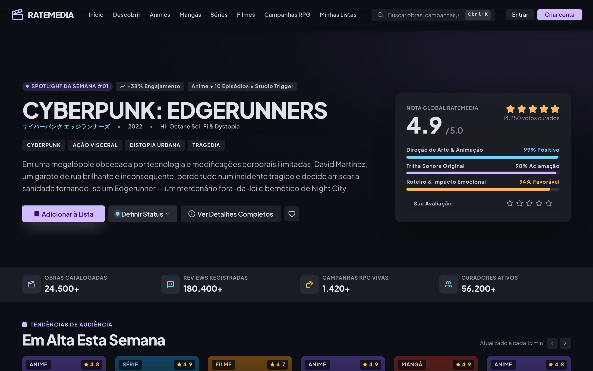
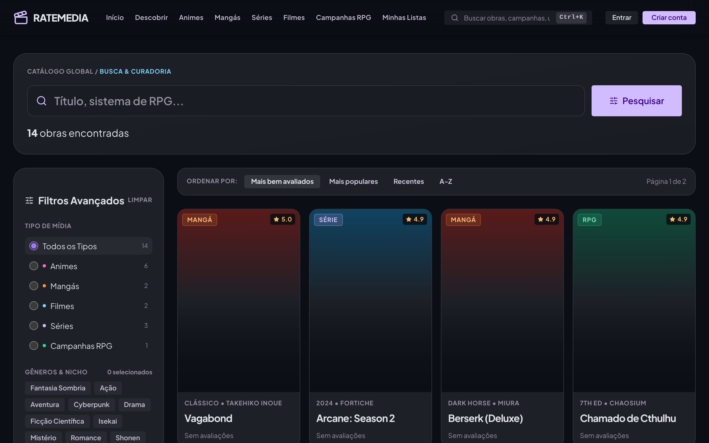
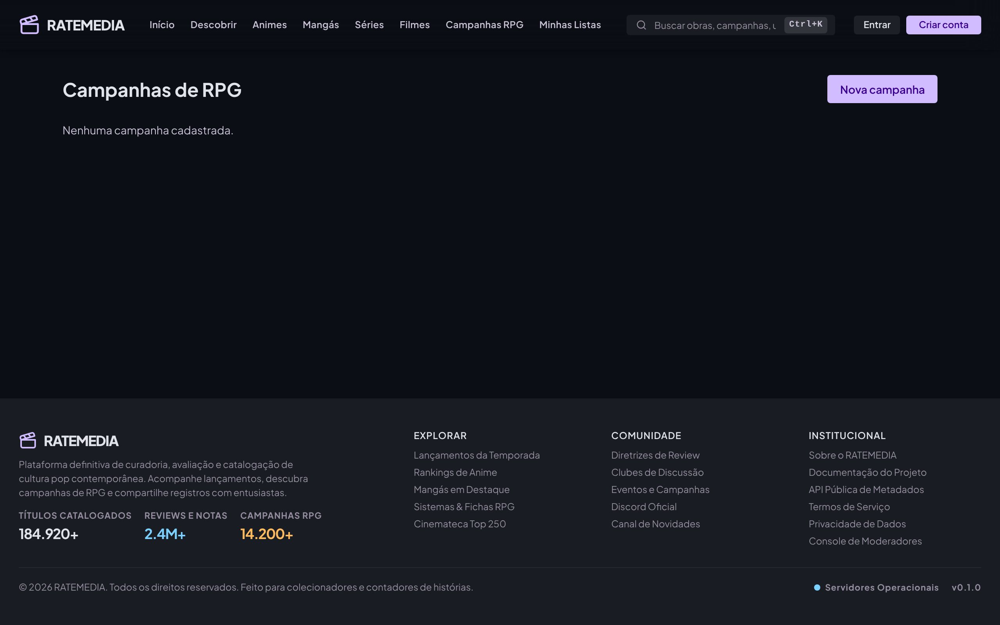
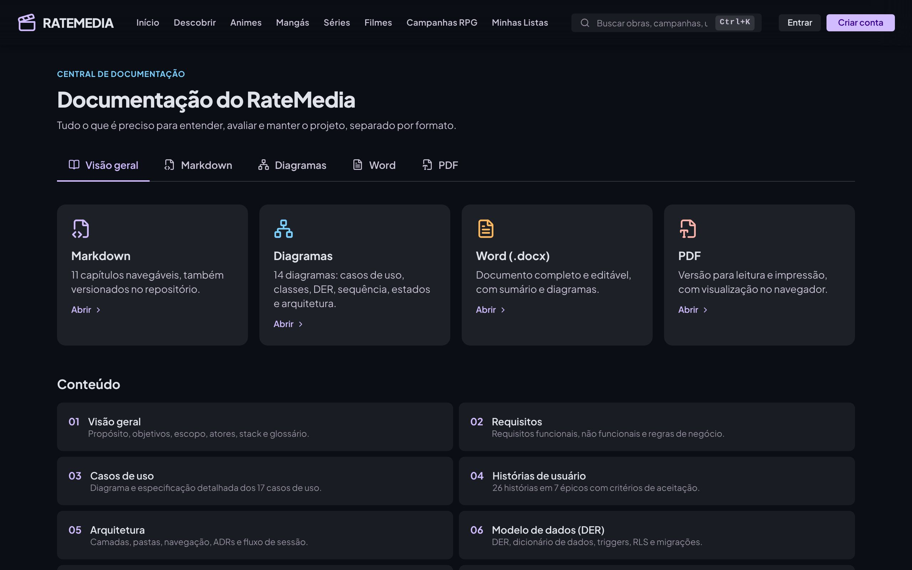
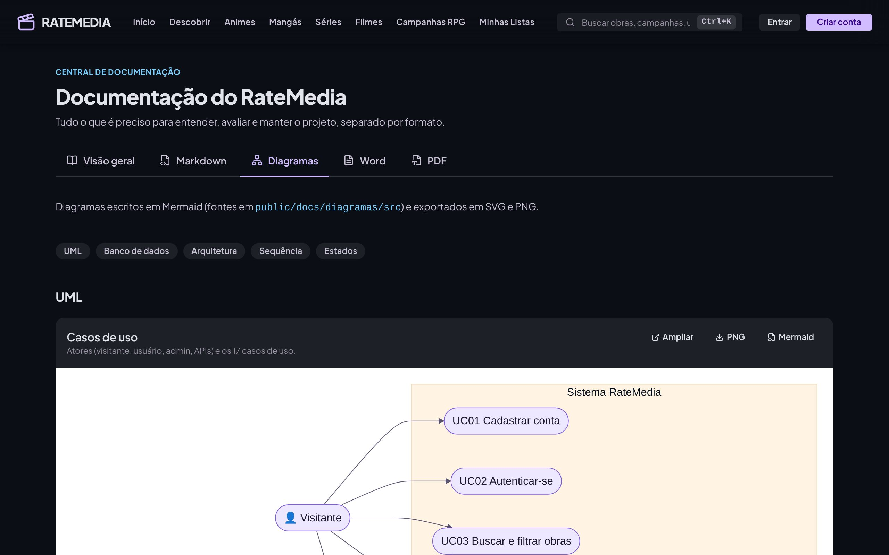
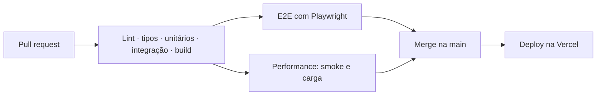

# RateMedia

**Acompanhe, avalie e resenhe animes, mangás, séries e filmes — e descubra campanhas de RPG criadas pela comunidade.**

[Sobre](#-sobre) · [Funcionalidades](#-funcionalidades) · [Arquitetura](#️-arquitetura) · [Qualidade](#-qualidade-e-cicd) · [Documentação](#-documentação) · [Wiki](https://github.com/LuisGlauser/RateMedia/wiki)

---

## 📌 Sobre

O **RateMedia** reúne em um só lugar o acompanhamento de **animes, mangás, séries e filmes**, no estilo do Letterboxd. O diferencial é o módulo de **campanhas de RPG de mesa**, criadas, divulgadas e avaliadas pela própria comunidade.

Projeto final da disciplina de **DevOps — Fatec**, construído com integração e entrega contínuas, testes automatizados em quatro níveis, contêiner Docker e segurança aplicada no banco de dados.

## ✨ Funcionalidades

| | Módulo | Descrição |
| --- | --- | --- |
| 🔎 | **Busca avançada** | Filtros por tipo, nota e gênero, quatro ordenações e paginação |
| 🎬 | **Página da obra** | Sinopse, metadados, média da comunidade e críticas com proteção de *spoiler* |
| 📚 | **Biblioteca pessoal** | Status, progresso e nota de 1 a 10 para cada obra |
| 🗂️ | **Listas e perfil** | Listas públicas ou privadas e perfil personalizável |
| 🎲 | **Campanhas de RPG** | Publicação, avaliação e descoberta de mesas da comunidade |
| 🛡️ | **Painel administrativo** | Métricas, curadoria do catálogo, importação do AniList, Jikan e TMDB, moderação e papéis |
| 📖 | **Central de documentação** | Requisitos, UML, DER, Word e PDF dentro da própria aplicação, em `/docs` |

<b>📸 Capturas de tela</b>

 

| Busca | Campanhas |
| --- | --- |
|  |  |
| **Documentação** | **Diagramas** |
|  |  |

## 🧰 Stack

| Camada | Tecnologias |
| --- | --- |
| Aplicação | Next.js 15 (App Router, Server Components, Server Actions), React 19, Tailwind CSS |
| Dados e autenticação | Supabase — PostgreSQL com Row Level Security e Auth |
| Integrações | AniList (GraphQL), Jikan (MyAnimeList) e TMDB |
| Testes | Vitest (unitários e integração), Playwright (E2E), teste de carga em Node |
| DevOps | GitHub Actions, Vercel, Docker e Docker Compose, Dependabot |

## 🏗️ Arquitetura

Monólito Next.js em que as páginas consultam o banco no servidor e as alterações passam por Server Actions validadas. As regras de acesso ficam no próprio PostgreSQL (RLS), e as integrações externas têm *cache*, novas tentativas e *fallback* entre provedores.

Mais detalhes em [Arquitetura](public/docs/md/05-arquitetura.md), [Modelo de dados](public/docs/md/06-modelo-de-dados.md) e [Diagramas de sequência](public/docs/md/08-diagramas-de-sequencia.md).

## ✅ Qualidade e CI/CD

Cada *pull request* passa pela pipeline do GitHub Actions antes de chegar à `main`:

| Nível | Ferramenta | Cobertura |
| --- | --- | --- |
| Unitário | Vitest | Regras de negócio: busca, formatação, permissões, clientes das APIs |
| Integração | Vitest | Server Actions, middleware e camada de dados com Supabase simulado |
| Ponta a ponta | Playwright | Fluxos reais no navegador: home, busca, filtros, login, campanhas |
| Performance | Node | Latência p95, vazão e taxa de erros com limites que reprovam a pipeline |

## 📖 Documentação

| Onde | Conteúdo |
| --- | --- |
| [**Wiki**](https://github.com/LuisGlauser/RateMedia/wiki) | Instalação, configuração, testes, deploy, guias de usuário e de administrador, FAQ |
| [`/docs`](public/docs/md/README.md) | Visão geral, requisitos, casos de uso, histórias de usuário, arquitetura, DER, classes, sequência, integrações, DevOps e testes |
| [Diagramas](public/docs/diagramas) | 14 diagramas (UML, DER, arquitetura, implantação) com fontes Mermaid |
| [Word](public/docs/word/RateMedia-Documentacao.docx) · [PDF](public/docs/pdf/RateMedia-Documentacao.pdf) | Documento completo para leitura, impressão e entrega |

> Para rodar o projeto na sua máquina, siga o guia de [Instalação](https://github.com/LuisGlauser/RateMedia/wiki/Instalação) na Wiki.

## 🗺️ Roadmap

- [x] Busca, biblioteca, listas e perfil
- [x] Campanhas de RPG com avaliações
- [x] Painel administrativo com importação de APIs externas
- [x] Docker, CI/CD e testes em quatro níveis
- [x] Central de documentação
- [ ] Monitoramento e alertas em produção
- [ ] Testes de RLS contra um Supabase local
- [ ] Notificações e feed de atividades

## 🤝 Contribuindo

Leia o [guia de contribuição](CONTRIBUTING.md) e o [código de conduta](CODE_OF_CONDUCT.md). Vulnerabilidades devem ser reportadas conforme a [política de segurança](SECURITY.md). O histórico de versões está no [CHANGELOG](CHANGELOG.md).

## 👥 Contribuidores

<table>
  <tr>
    <td align="center" width="25%"><a href="https://github.com/LuisGlauser"> <b>Luís Felipe Glauser Lucas</b></a> Telas, Supabase e integrações com APIs</td>
    <td align="center" width="25%"><a href="https://github.com/FelipeFDSDev"> <b>Felipe Ferreira de Souza</b></a> Docker e containerização</td>
    <td align="center" width="25%"><a href="https://github.com/gabrieldasilva88188"> <b>@gabrieldasilva88188</b></a> Testes unitários, integração, E2E e performance</td>
    <td align="center" width="25%"><a href="https://github.com/Dracon-46"> <b>Arthur Gaspare Camzano</b></a> Documentação e padronização do repositório</td>
  </tr>
</table>

Veja todas as contribuições em [Insights → Contributors](https://github.com/LuisGlauser/RateMedia/graphs/contributors).

Projeto acadêmico · DevOps · Fatec

