# 3. Casos de Uso

## 3.1 Diagrama de casos de uso

## 3.2 Lista de casos de uso

| ID | Caso de uso | Atores | RF |
| --- | --- | --- | --- |
| UC01 | Cadastrar conta | Visitante | RF01 |
| UC02 | Autenticar-se | Visitante | RF02 |
| UC03 | Buscar e filtrar obras | Visitante, Usuário | RF04–RF06 |
| UC04 | Visualizar obra | Visitante, Usuário | RF07 |
| UC05 | Gerenciar biblioteca (status e progresso) | Usuário | RF08, RF09, RF12 |
| UC06 | Avaliar e resenhar obra | Usuário | RF10, RF11 |
| UC07 | Gerenciar listas | Usuário | RF13 |
| UC08 | Adicionar obra a lista | Usuário | RF14 |
| UC09 | Editar perfil | Usuário | RF15 |
| UC10 | Visualizar campanhas de RPG | Visitante, Usuário | RF16 |
| UC11 | Criar/editar/excluir campanha | Usuário, Admin | RF17, RF18 |
| UC12 | Avaliar campanha | Usuário | RF19 |
| UC13 | Gerenciar catálogo (CRUD) | Admin | RF20, RF21 |
| UC14 | Importar obra externa | Admin, APIs externas | RF22 |
| UC15 | Moderar conteúdo | Admin | RF23 |
| UC16 | Gerenciar papéis de usuários | Admin | RF24 |
| UC17 | Encerrar sessão | Usuário | RF03 |

## 3.3 Especificações detalhadas

### UC01 — Cadastrar conta

| Campo | Descrição |
| --- | --- |
| **Ator principal** | Visitante |
| **Pré-condições** | Não estar autenticado. |
| **Pós-condições** | Usuário criado em `auth.users`, perfil criado em `profiles`, sessão ativa. |

**Fluxo principal**
1. O visitante acessa `/cadastro`.
2. Informa username, e-mail e senha.
3. O sistema valida a senha (mínimo 6 caracteres).
4. O sistema cria o usuário no Supabase Auth com o username nos metadados.
5. O trigger `handle_new_user` cria o perfil.
6. O sistema redireciona para a página inicial já autenticado.

**Fluxos alternativos**
- **A1 — Senha curta:** exibe “A senha deve ter ao menos 6 caracteres.” e permanece no formulário.
- **A2 — E-mail já cadastrado / erro do provedor:** exibe a mensagem retornada pelo Supabase.

### UC02 — Autenticar-se

| Campo | Descrição |
| --- | --- |
| **Ator principal** | Visitante |
| **Pré-condições** | Possuir conta. |
| **Pós-condições** | Cookies de sessão gravados; navbar mostra o menu do usuário. |

**Fluxo principal**
1. O visitante acessa `/login` (possivelmente com `?next=/rota`).
2. Informa e-mail e senha.
3. O sistema autentica via `signInWithPassword`.
4. O sistema redireciona para `next` (somente caminhos internos iniciados por `/`).

**Fluxo alternativo**
- **A1 — Credenciais inválidas:** exibe “E-mail ou senha inválidos.”.

### UC03 — Buscar e filtrar obras

**Ator:** Visitante ou Usuário. **Pré-condição:** nenhuma.

**Fluxo principal**
1. O ator digita um termo na barra de busca ou acessa `/busca`.
2. Seleciona o tipo (anime, mangá, série, filme, RPG ou todos).
3. Opcionalmente aplica faixa de nota (0–5) e gêneros.
4. Escolhe a ordenação (nota, popularidade, recentes, A–Z).
5. O sistema retorna 12 resultados por página com navegação por páginas.

**Fluxo alternativo**
- **A1 — Nenhum resultado:** o sistema exibe estado vazio com sugestão para limpar filtros.

### UC04 — Visualizar obra

1. O ator abre `/obras/{id}`.
2. O sistema exibe capa, título, subtítulo, ano, gêneros, unidades, sinopse, média de notas e críticas.
3. Críticas marcadas com spoiler ficam ocultas até o clique do leitor.
4. Se autenticado, exibe os controles de biblioteca, avaliação e “Adicionar à lista” (UC05, UC06, UC08).

### UC05 — Gerenciar biblioteca

| Campo | Descrição |
| --- | --- |
| **Ator principal** | Usuário autenticado |
| **Pré-condições** | Sessão ativa; obra existente. |
| **Pós-condições** | Registro em `library_entries` criado ou atualizado. |

**Fluxo principal**
1. Na página da obra, o usuário escolhe um status.
2. Informa o progresso (episódios/capítulos).
3. O sistema executa `saveEntry`, que faz *upsert* por `(user_id, media_id)` salvando apenas os campos enviados.
4. A obra passa a aparecer em `/minha-biblioteca` no grupo do status.

**Fluxo alternativo**
- **A1 — Sem sessão:** redireciona para `/login?next=/obras/{id}`.

### UC06 — Avaliar e resenhar obra

**Inclui:** UC05 (a avaliação é armazenada na mesma entrada da biblioteca).

1. O usuário escolhe uma nota de 1 a 10.
2. Escreve a resenha e marca “contém spoilers”, se for o caso.
3. O sistema converte a nota (`/2`) e grava `rating`, `review` e `has_spoilers`.
4. A média da obra e a lista de críticas são revalidadas.

**Alternativo:** nota fora do intervalo é gravada como `null` (sem nota).

### UC07 — Gerenciar listas

1. O usuário acessa `/listas` (perfil + minhas listas).
2. Cria uma lista com título (até 80 caracteres), descrição (até 300) e visibilidade.
3. Abre uma lista em `/listas/{id}` para ver ou remover itens.
4. Pode excluir a lista (somente o dono).

### UC08 — Adicionar obra a lista (*extend* UC07)

1. Na página da obra, o usuário clica em “Adicionar à lista”.
2. O sistema carrega as listas do usuário indicando em quais a obra já está.
3. O usuário marca/desmarca listas; o sistema insere/remove `list_items` na última posição.
4. **Alternativo:** o usuário cria uma nova lista que já nasce com a obra.
5. **Exceção:** obra já presente (erro `23505`) é tratada como sucesso.

### UC09 — Editar perfil

1. Em `/listas`, o usuário edita bio (300), localização (80), URL do avatar e URL do banner.
2. URLs que não começam com `http(s)://` são descartadas.
3. O sistema atualiza `profiles` do próprio usuário.

### UC10 — Visualizar campanhas

1. O ator acessa `/campanhas`.
2. O sistema lista campanhas com sistema, status, nota média e número de avaliações.
3. Ao abrir `/campanhas/{id}`, vê sinopse, regras e avaliações.

### UC11 — Criar/editar/excluir campanha

| Campo | Descrição |
| --- | --- |
| **Atores** | Usuário (autor), Administrador |
| **Pré-condições** | Sessão ativa; para editar/excluir, ser autor ou admin. |

**Fluxo principal (criar)**
1. O usuário acessa `/campanhas/nova`.
2. Preenche título (150), sistema (80), sinopse (4000), regras (4000), status e URL da capa.
3. O sistema valida campos obrigatórios (título, sistema, sinopse) e grava com `author_id` do usuário.
4. Redireciona para `/campanhas/{id}`.

**Fluxo alternativo (editar/excluir)**
1. Autor ou admin acessa `/campanhas/{id}/editar` ou o painel `/admin/campanhas`.
2. O sistema executa `authorize()` (getViewer + `canManageCampaign`).
3. Atualiza ou exclui; exclusão redireciona apenas para `/campanhas` ou `/admin/campanhas`.

**Exceção:** usuário sem permissão — a operação é ignorada (e bloqueada também pela RLS).

### UC12 — Avaliar campanha

1. Na página da campanha, o usuário define nota (0–5) e comentário.
2. O sistema faz *upsert* por `(campaign_id, user_id)`.
3. A média da campanha é recalculada na próxima renderização.

### UC13 — Gerenciar catálogo

**Ator:** Administrador. **Pré-condição:** `role = 'admin'`.

1. O admin acessa `/admin/catalogo` e vê a tabela de obras.
2. Cria (`/admin/catalogo/nova`) ou edita (`/admin/catalogo/{id}`) obras: tipo, título, subtítulo, sinopse, capa, ano, unidades, até 8 gêneros e status editorial.
3. Exclui obras (exclusão em cascata remove entradas e itens de lista).

### UC14 — Importar obra externa

**Atores:** Administrador, APIs externas.

1. O admin acessa `/admin/catalogo/importar` e pesquisa por título e tipo.
2. O sistema consulta AniList (anime/mangá, com *fallback* para Jikan) ou TMDB (filme/série).
3. O admin clica em “Importar”; o formulário envia apenas tipo, fonte e id externo.
4. O servidor busca os dados completos na API (o cliente não injeta conteúdo) e grava com `ignoreDuplicates`.
5. O sistema exibe confirmação (`?ok=1`).

**Exceções:** `erro=api` (API indisponível), `erro=nao-encontrada`, `erro=db`.

### UC15 — Moderar conteúdo

1. O admin acessa `/admin/moderacao`.
2. Pode limpar o texto de uma resenha (nota preservada) ou excluir uma avaliação de campanha.

### UC16 — Gerenciar papéis

1. O admin acessa `/admin/usuarios`.
2. Altera o papel de outro usuário para `admin` ou `user`.
3. **Restrição:** o admin não pode alterar o próprio papel.

### UC17 — Encerrar sessão

1. O usuário abre o menu do avatar e clica em “Sair”.
2. O sistema invalida a sessão e redireciona para `/`.
