# 5. Arquitetura

## 5.1 Visão geral

O RateMedia é um **monólito Next.js** (front-end e back-end no mesmo projeto) que usa o **Supabase** como *Backend-as-a-Service* (autenticação + PostgreSQL). As páginas são **Server Components** que consultam o banco diretamente; mutações são feitas por **Server Actions** chamadas pelos formulários. A segurança é aplicada em duas camadas: validação no servidor e **RLS** no banco.



## 5.2 Camadas

| Camada | Local | Responsabilidade |
| --- | --- | --- |
| Apresentação | `src/app/**/page.tsx`, `src/components/**` | Renderização (RSC + componentes cliente), Tailwind. |
| Roteamento/Proteção | `src/middleware.ts` | Renova a sessão Supabase em cada requisição e redireciona visitantes de rotas protegidas. |
| Aplicação | `src/app/**/actions.ts`, `src/lib/actions/*` | Server Actions: validação, autorização, mutações e `revalidatePath`. |
| Domínio/Utilitários | `src/lib/data.ts`, `search.ts`, `format.ts`, `constants.ts` | Médias, estatísticas, filtros, ordenação, paginação, rótulos. |
| Integração | `src/lib/external/*` | Clientes AniList/Jikan/TMDB, normalização (`ExternalMedia`), retry/timeout. |
| Dados | `src/lib/supabase/*`, `supabase/*.sql` | Clientes Supabase (server/browser), schema, migrações e políticas RLS. |

## 5.3 Estrutura de pastas

```
src/
  app/
    (site)/                 site público (Navbar + Footer)
      (auth)/               login, cadastro e actions de autenticação
      (app)/busca/          busca avançada
      (app)/listas/         perfil + listas (e /listas/[id])
      (app)/minha-biblioteca/
      obras/[id]/           detalhe da obra
      campanhas/            listagem, criação, edição e detalhe
      docs/                 central de documentação (md, diagramas, word, pdf)
    (admin)/admin/          painel administrativo (layout com sidebar)
  components/               UI reutilizável (home, busca, obra, perfil, admin, docs)
  lib/                      supabase, external, data, search, format, constants
  middleware.ts
  types/index.ts            tipos de domínio
supabase/
  schema.sql                tabelas, enums, triggers, RLS
  migrations/               002 (gêneros, perfil, admin) e 003 (correções)
public/docs/                arquivos da documentação (md, diagramas, word, pdf)
```

## 5.4 Mapa de navegação



🔒 = exige sessão (middleware) · 🛡️ = exige `role = admin` (`requireAdmin()` + RLS).

## 5.5 Decisões arquiteturais (ADR resumidas)

| # | Decisão | Motivo | Consequência |
| --- | --- | --- | --- |
| ADR-01 | Next.js App Router com Server Actions | Um único projeto para UI e API, sem camada REST própria. | Menos código; acoplamento ao Next. |
| ADR-02 | Supabase (Auth + Postgres) | Autenticação pronta, Postgres gerenciado e plano gratuito. | Dependência de serviço externo. |
| ADR-03 | Segurança por RLS | A regra de acesso vive no banco e vale para qualquer cliente. | Políticas precisam ser testadas e versionadas. |
| ADR-04 | Importação feita no servidor | O cliente envia só `type/source/id`; impede injeção de dados. | Uma chamada extra à API na importação. |
| ADR-05 | AniList como fonte principal e Jikan como *fallback* | Disponibilidade variável das APIs. | Dois normalizadores para manter. |
| ADR-06 | Dados de demonstração sem Supabase | Permite avaliar a UI sem credenciais (Docker/preview). | Páginas precisam tratar os dois modos. |
| ADR-07 | `output: "standalone"` | Imagem Docker pequena. | Nenhuma no deploy Vercel. |

## 5.6 Fluxo de autenticação e sessão

1. `@supabase/ssr` guarda o token em cookies HTTP.
2. O `middleware.ts` cria um cliente com os cookies da requisição, chama `auth.getUser()` (renovando o token se preciso) e reescreve os cookies na resposta.
3. Se a rota estiver em `PROTECTED` e não houver usuário, redireciona para `/login?next=<rota>`.
4. Server Components e Server Actions usam `createClient()` de `lib/supabase/server.ts`, que lê os mesmos cookies.
