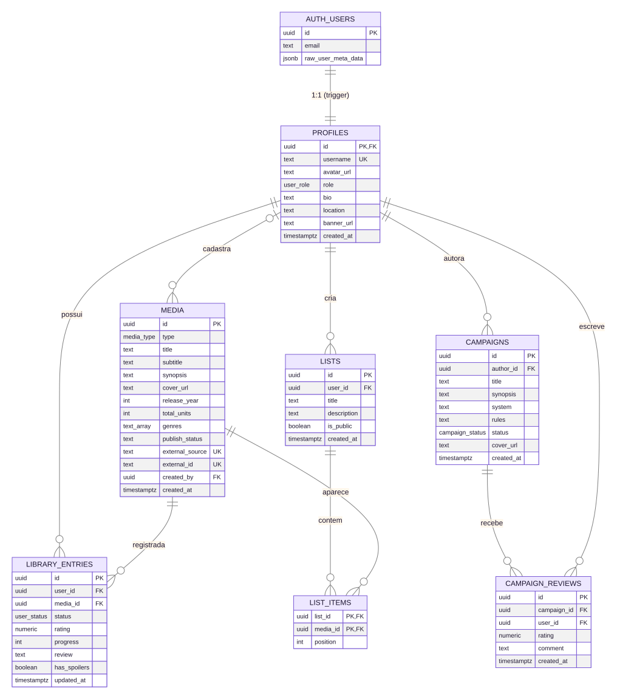

# 6. Modelo de Dados

## 6.1 Diagrama Entidade-Relacionamento (DER)

## 6.2 Tipos enumerados

| Enum | Valores |
| --- | --- |
| `media_type` | `anime`, `manga`, `series`, `movie` |
| `user_status` | `planned`, `in_progress`, `completed`, `dropped` |
| `campaign_status` | `recruiting`, `ongoing`, `finished`, `paused` |
| `user_role` | `user`, `admin` |
| `publish_status` (check) | `published`, `draft`, `review` |

## 6.3 Dicionário de dados

### profiles
| Coluna | Tipo | Restrições | Descrição |
| --- | --- | --- | --- |
| id | uuid | PK, FK → auth.users (cascade) | Mesmo id do usuário de autenticação. |
| username | text | unique, not null | Nome público. |
| avatar_url | text | | URL da foto. |
| role | user_role | not null, default `user` | Papel de acesso. |
| bio | text | | Biografia (≤ 300). |
| location | text | | Localização (≤ 80). |
| banner_url | text | | URL do banner. |
| created_at | timestamptz | default now() | Data de criação. |

### media
| Coluna | Tipo | Restrições | Descrição |
| --- | --- | --- | --- |
| id | uuid | PK | Identificador. |
| type | media_type | not null, índice | Tipo da obra. |
| title | text | not null, índice GIN full-text | Título. |
| subtitle | text | | Estúdio, autor ou emissora. |
| synopsis | text | | Sinopse (≤ 4000). |
| cover_url | text | | Capa. |
| release_year | int | | Ano de lançamento. |
| total_units | int | | Episódios/capítulos/1. |
| genres | text[] | not null, default `{}`, índice GIN | Gêneros (≤ 8). |
| publish_status | text | check, default `published` | Status editorial. |
| external_source | text | unique (com external_id) | `anilist`, `jikan`, `tmdb` ou `manual`. |
| external_id | text | unique (com external_source) | `tipo:id` (ex.: `anime:20`). |
| created_by | uuid | FK → profiles | Admin que cadastrou. |
| created_at | timestamptz | default now() | |

### library_entries
| Coluna | Tipo | Restrições | Descrição |
| --- | --- | --- | --- |
| id | uuid | PK | |
| user_id | uuid | FK → profiles (cascade), unique com media_id | Dono. |
| media_id | uuid | FK → media (cascade) | Obra. |
| status | user_status | default `planned` | Situação. |
| rating | numeric(2,1) | check 0–5 | Nota. |
| progress | int | default 0 | Unidades consumidas. |
| review | text | | Resenha. |
| has_spoilers | boolean | default false | Marca de spoiler. |
| updated_at | timestamptz | default now() | Última alteração. |

### lists / list_items
| Tabela.Coluna | Tipo | Restrições | Descrição |
| --- | --- | --- | --- |
| lists.id | uuid | PK | |
| lists.user_id | uuid | FK → profiles (cascade) | Dono. |
| lists.title | text | not null | Título (≤ 80). |
| lists.description | text | | Descrição (≤ 300). |
| lists.is_public | boolean | default true | Visibilidade. |
| list_items.list_id | uuid | PK, FK → lists (cascade) | |
| list_items.media_id | uuid | PK, FK → media (cascade) | |
| list_items.position | int | default 0 | Ordem na lista. |

### campaigns / campaign_reviews
| Tabela.Coluna | Tipo | Restrições | Descrição |
| --- | --- | --- | --- |
| campaigns.id | uuid | PK | |
| campaigns.author_id | uuid | FK → profiles (cascade) | Mestre. |
| campaigns.title | text | not null | (≤ 150). |
| campaigns.synopsis | text | not null | (≤ 4000). |
| campaigns.system | text | not null | Ex.: D&D 5e, Tormenta20. |
| campaigns.rules | text | | Regras da mesa. |
| campaigns.status | campaign_status | default `recruiting` | |
| campaigns.cover_url | text | | |
| campaign_reviews.id | uuid | PK | |
| campaign_reviews.campaign_id | uuid | FK → campaigns (cascade), unique com user_id | |
| campaign_reviews.user_id | uuid | FK → profiles (cascade) | |
| campaign_reviews.rating | numeric(2,1) | not null, check 0–5 | |
| campaign_reviews.comment | text | | |

## 6.4 Funções e triggers

| Objeto | Tipo | Descrição |
| --- | --- | --- |
| `is_admin()` | função SQL `security definer` | Retorna se `auth.uid()` tem `role = 'admin'`. Usada nas políticas. |
| `handle_new_user()` | função PL/pgSQL | Cria o perfil com o username dos metadados ou a parte local do e-mail. |
| `on_auth_user_created` | trigger `after insert on auth.users` | Executa `handle_new_user()`. |

## 6.5 Políticas de Row Level Security

| Tabela | Leitura | Escrita |
| --- | --- | --- |
| profiles | todos | o próprio (sem trocar `role`); admin atualiza qualquer um |
| media | todos | somente admin |
| library_entries | todos | o dono; admin pode atualizar (moderação) |
| lists | públicas ou do dono | o dono |
| list_items | se a lista for pública ou do dono | o dono da lista |
| campaigns | todos | autor ou admin |
| campaign_reviews | todos | autor da avaliação ou admin |

## 6.6 Migrações

| Arquivo | Conteúdo |
| --- | --- |
| `supabase/schema.sql` | Schema inicial: enums, tabelas, índices, `is_admin`, trigger e RLS. |
| `migrations/002_telas_busca_perfil_admin.sql` | `genres`, `subtitle`, `publish_status`; `bio`, `location`, `banner_url`; política `profiles_admin_update`. |
| `migrations/003_fix_has_spoilers_e_colunas.sql` | Garante `has_spoilers`, `review`, `progress`, `is_public` e recarrega o schema do PostgREST. |
