# 7. Diagrama de Classes

O diagrama abaixo representa o **modelo de domínio** (interfaces TypeScript em `src/types/index.ts`, que espelham as tabelas) e a **camada de integração** com APIs externas (`src/lib/external`).

## 7.1 Classes de domínio

| Classe | Arquivo | Responsabilidade |
| --- | --- | --- |
| `Profile` | `types/index.ts` | Usuário público; papel `user`/`admin`. |
| `Media` | `types/index.ts` | Obra do catálogo. |
| `LibraryEntry` | `types/index.ts` | Relação usuário × obra com status, progresso, nota e resenha. |
| `List` / `ListItem` | tabelas `lists`, `list_items` | Coleções ordenadas de obras. |
| `Campaign` | `types/index.ts` | Campanha de RPG. |
| `CampaignReview` | `types/index.ts` | Avaliação de campanha. |

## 7.2 Integração externa

| Elemento | Arquivo | Descrição |
| --- | --- | --- |
| `ExternalMedia` | `external/types.ts` | DTO normalizado de qualquer fonte. |
| `ExternalProvider` (conceitual) | `external/{anilist,jikan,tmdb}.ts` | Cada módulo expõe `search*` e `get*`. |
| `ExternalApiError` | `external/types.ts` | Erro de rede/HTTP; dispara o *fallback*. |
| `fetchJson` | `external/http.ts` | GET/POST com timeout, cache e retry. |
| `searchExternal`, `searchAllExternal`, `fetchExternal` | `external/index.ts` | Fachada que roteia por tipo e fonte. |
| `SOURCES_BY_TYPE`, `storageId` | `external/types.ts` | Fontes permitidas por tipo e chave única `tipo:id`. |

## 7.3 Serviços e utilitários

| Função | Arquivo | Descrição |
| --- | --- | --- |
| `average`, `mediaStats`, `campaignStats` | `lib/data.ts` | Médias e contagem de avaliações. |
| `getViewer`, `requireAdmin`, `canManageCampaign` | `lib/data.ts` | Autorização no servidor. |
| `filterItems`, `sortItems`, `paginate`, `buildQuery` | `lib/search.ts` | Busca avançada. |
| `statusLabel` | `lib/constants.ts` | Rótulos por tipo (ler × assistir). |
| `timeAgo` | `lib/format.ts` | Datas relativas em pt-BR. |

## 7.4 Diagramas de estado

**Status de uma obra na biblioteca**

**Status de uma campanha**

