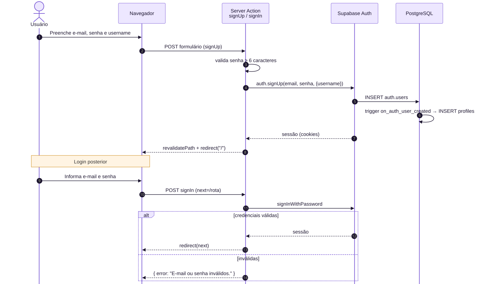
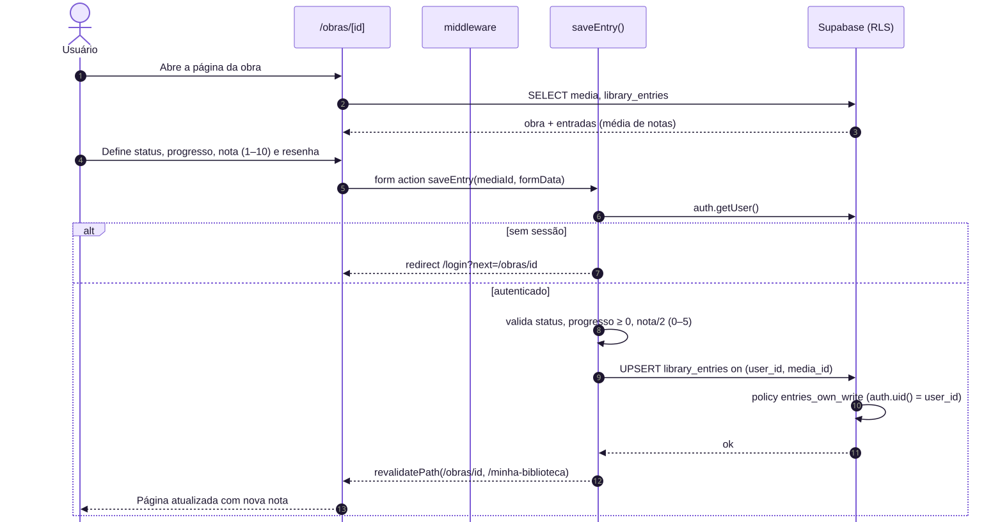
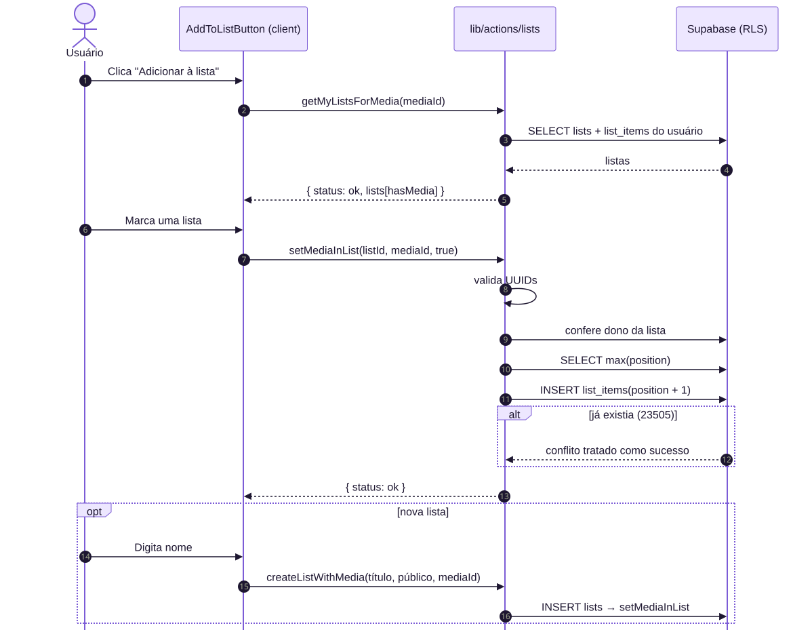
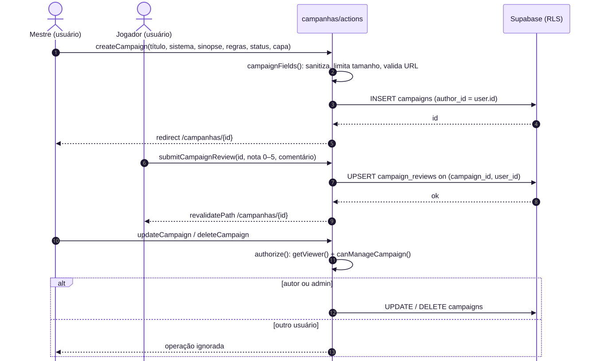
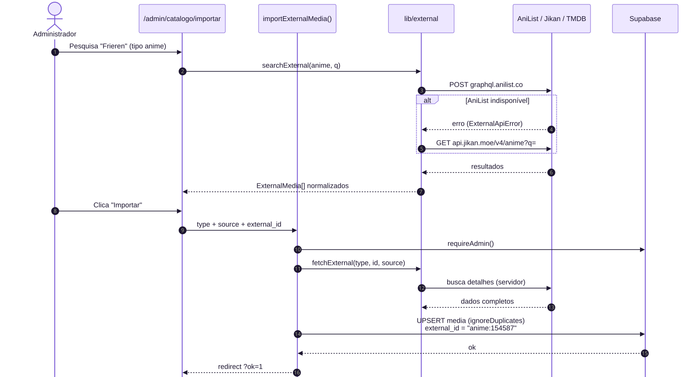
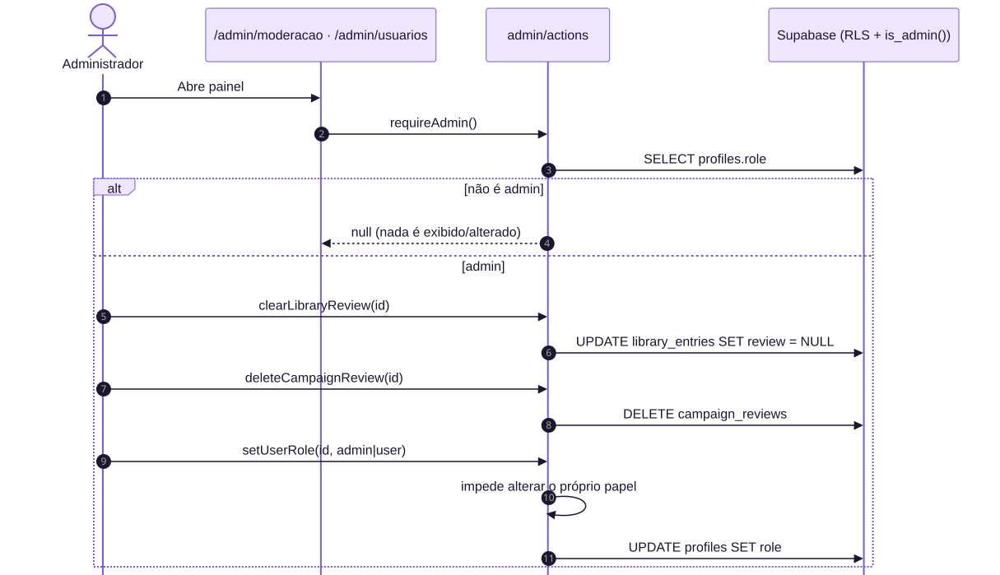

# 8. Diagramas de Sequência

## 8.1 Cadastro e login (UC01, UC02)

## 8.2 Avaliar e resenhar obra (UC05, UC06)

## 8.3 Adicionar obra a uma lista (UC08)

## 8.4 Criar, avaliar e gerenciar campanha (UC11, UC12)

## 8.5 Importar obra de API externa (UC14)

## 8.6 Moderação e papéis (UC15, UC16)

