# 10. DevOps: CI/CD, Docker e Deploy

## 10.1 Diagrama de implantação



## 10.2 Integração contínua (GitHub Actions)

Arquivo: `.github/workflows/ci.yml` — executa em *push* e *pull request* para `main` e `develop` (e manualmente). Os jobs compartilham a action local `.github/actions/setup` (Node 22 + `npm ci` com cache).

| Job | Depende de | O que faz |
| --- | --- | --- |
| **Lint** | — | ESLint |
| **Checagem de tipos** | — | `tsc --noEmit` |
| **Testes unitários** | — | `npm run test:unit` |
| **Testes de integração** | — | `npm run test:integration` |
| **Build** (matriz) | — | Build em modo demonstração e com variáveis do Supabase, com cache do Next.js |
| **Testes E2E** | lint, tipos, unitários, integração | Build demo → Playwright (Chromium em cache) → publica `playwright-report` |
| **Testes de performance** | lint, tipos, unitários, integração | Sobe o servidor → perfis *smoke* e *load* → publica resultados |
| **Imagem Docker** | — | `docker build` + sobe o contêiner e verifica se responde |
| **Varredura de segredos** | — | gitleaks em todo o histórico |
| **Auditoria de dependências** | — | `npm audit` das dependências de produção, com resumo no job (bloqueante se `AUDIT_BLOCKING=true`) |
| **CI OK** | todos | Falha se qualquer job falhar ou for cancelado; é o check obrigatório da `main` |
| **Deploy de produção** | CI OK (só em push na `main`) | Build → deploy sem trocar o domínio → promove para `ratemedia.vercel.app` → smoke test; se o smoke falhar, volta para a versão anterior |

Outros workflows:

| Arquivo | Gatilho | O que faz |
| --- | --- | --- |
| `codeql.yml` | push e PR | Análise estática de segurança com CodeQL |
| `deploy.yml` (Pós-deploy) | `deployment_status` ou manual | Smoke test das rotas `/`, `/busca`, `/login` e `/docs` no site publicado |

Sem as variáveis do Supabase, o build usa o catálogo de demonstração, garantindo dados previsíveis e nenhum acesso ao banco real.

## 10.3 Entrega contínua (Vercel)

**Produção:** https://ratemedia.vercel.app

O deploy de produção é feito pela própria pipeline, no job **Deploy de produção**, e segue estas regras:

1. Só roda em push na `main` e só depois que o **CI OK** passar. Se qualquer teste, build, verificação de segurança ou o Docker falhar, **nada é publicado** e o site continua na versão anterior.
2. O build roda dentro da pipeline (`vercel build`). Se ele falhar, nenhum deploy é criado.
3. A versão nova é enviada sem trocar o domínio (`vercel deploy --skip-domain`) e só então promovida (`vercel promote`).
4. Um smoke test verifica as rotas principais no domínio público. Se alguma não responder, a pipeline executa `vercel rollback` e o site volta para a versão que estava no ar.
5. Cada deploy aparece no ambiente **production** do GitHub, com o resumo (commit, versão anterior, versão nova e resultado do smoke test).

Requisitos: secret `VERCEL_TOKEN` no repositório e variáveis de ambiente cadastradas no projeto da Vercel (*Settings → Environment Variables*).

## 10.4 Docker

- `Dockerfile` *multi-stage*: `deps` (npm ci) → `builder` (`next build` com `output: "standalone"`) → `runner` (`node:22-alpine`, usuário `nextjs` sem privilégios, porta 3000).
- `docker-compose.yml`: serviço `app`, variáveis do `.env.local`, `restart: unless-stopped` e *healthcheck* HTTP.
- `.dockerignore` exclui dependências, artefatos de build e arquivos de ambiente do contexto.

```bash
docker compose --env-file .env.local up --build
```

## 10.5 Execução local

```bash
npm install
cp .env.example .env.local   # preencher Supabase (e TMDB opcional)
npm run dev                  # http://localhost:3000
```

Banco: executar `supabase/schema.sql` e depois as migrações `002` e `003` no SQL Editor do Supabase. Para tornar um usuário admin:

```sql
update profiles set role = 'admin' where username = 'seu_usuario';
```

## 10.6 Fluxo de trabalho Git

1. Criar *branch* a partir da `main` (`feat/…`, `fix/…`, `docs/…`).
2. Commits pequenos e descritivos (Conventional Commits: `feat:`, `fix:`, `docs:`, `build:`).
3. Abrir *pull request* → CI + preview na Vercel.
4. Revisão e *merge* → produção.

## 10.7 Segurança operacional

- Segredos somente em variáveis de ambiente (Vercel, GitHub, `.env.local`).
- Nenhuma chave `service_role` no projeto: todo acesso usa a chave *anon* + RLS.
- Contêiner sem *root*; permissões mínimas no workflow (`contents: read`).
