# 10. DevOps: CI/CD, Docker e Deploy

## 10.1 Diagrama de implantação



## 10.2 Integração contínua (GitHub Actions)

Arquivo: `.github/workflows/ci.yml` — executa em *push* e *pull request* para `main`.

| Etapa | Comando | Objetivo |
| --- | --- | --- |
| Checkout | `actions/checkout@v4` | Baixar o código. |
| Node 22 + cache npm | `actions/setup-node@v4` | Ambiente reprodutível. |
| Dependências | `npm ci` | Instalação travada pelo `package-lock.json`. |
| Lint | `npm run lint` | Padrões de código (ESLint). |
| Tipos | `npm run typecheck` | `tsc --noEmit`. |
| Testes | `npm test` | Vitest. |
| Build | `npm run build` | Build de produção com variáveis *placeholder*. |
| Auditoria | `npm audit --audit-level=high` | Vulnerabilidades (não bloqueante). |

## 10.3 Entrega contínua (Vercel)

- O repositório é importado na Vercel (framework **Next.js**, comando `npm run build`).
- Cada *pull request* gera um **deploy de preview** com URL própria.
- O *merge* na `main` publica em **produção**.
- Variáveis de ambiente são configuradas no painel da Vercel (*Settings → Environment Variables*).
- A central de documentação fica disponível em **`/docs`** no mesmo deploy.

## 10.4 Docker

- `Dockerfile` *multi-stage*: `deps` (npm ci) → `builder` (`next build` com `output: "standalone"`) → `runner` (`node:22-alpine`, usuário `nextjs` sem privilégios, porta 3000).
- `docker-compose.yml`: serviço `app`, variáveis do `.env.local`, `restart: unless-stopped` e *healthcheck* HTTP.
- `.dockerignore` exclui dependências, artefatos de build e arquivos de ambiente do contexto.

```bash
docker compose --env-file .env.local up --build
```

## 10.5 Execução local

```bash
npm install
cp .env.example .env.local   # preencher Supabase (e TMDB opcional)
npm run dev                  # http://localhost:3000
```

Banco: executar `supabase/schema.sql` e depois as migrações `002` e `003` no SQL Editor do Supabase. Para tornar um usuário admin:

```sql
update profiles set role = 'admin' where username = 'seu_usuario';
```

## 10.6 Fluxo de trabalho Git

1. Criar *branch* a partir da `main` (`feat/…`, `fix/…`, `docs/…`).
2. Commits pequenos e descritivos (Conventional Commits: `feat:`, `fix:`, `docs:`, `build:`).
3. Abrir *pull request* → CI + preview na Vercel.
4. Revisão e *merge* → produção.

## 10.7 Segurança operacional

- Segredos somente em variáveis de ambiente (Vercel, GitHub, `.env.local`).
- Nenhuma chave `service_role` no projeto: todo acesso usa a chave *anon* + RLS.
- Contêiner sem *root*; permissões mínimas no workflow (`contents: read`).
