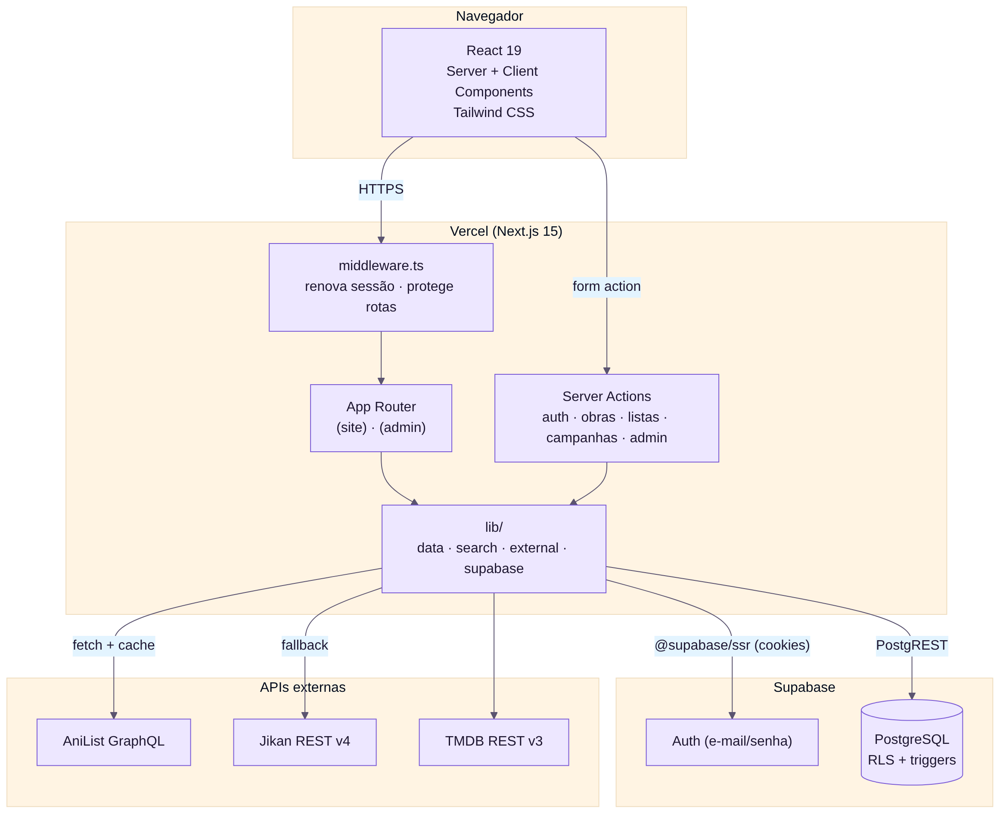

# Arquitetura

- **Next.js 15 (App Router):** páginas como Server Components e mutações como Server Actions.
- **Supabase:** autenticação por e-mail/senha (cookies via `@supabase/ssr`) e PostgreSQL com RLS.
- **Integrações:** AniList (principal) com *fallback* para Jikan em animes/mangás; TMDB para filmes/séries.
- **middleware.ts:** renova a sessão e protege `/minha-biblioteca`, `/listas`, `/campanhas/nova` e `/admin`.

## Pastas

| Pasta | Conteúdo |
| --- | --- |
| `src/app/(site)` | Site público |
| `src/app/(admin)/admin` | Painel administrativo |
| `src/components` | Componentes de interface |
| `src/lib` | Supabase, integrações, busca, dados |
| `supabase` | Schema e migrações |
| `public/docs` | Documentação |

Detalhes: [Arquitetura completa](https://github.com/LuisGlauser/RateMedia/blob/main/public/docs/md/05-arquitetura.md) · [Classes](https://github.com/LuisGlauser/RateMedia/blob/main/public/docs/md/07-diagrama-de-classes.md) · [Sequência](https://github.com/LuisGlauser/RateMedia/blob/main/public/docs/md/08-diagramas-de-sequencia.md).
