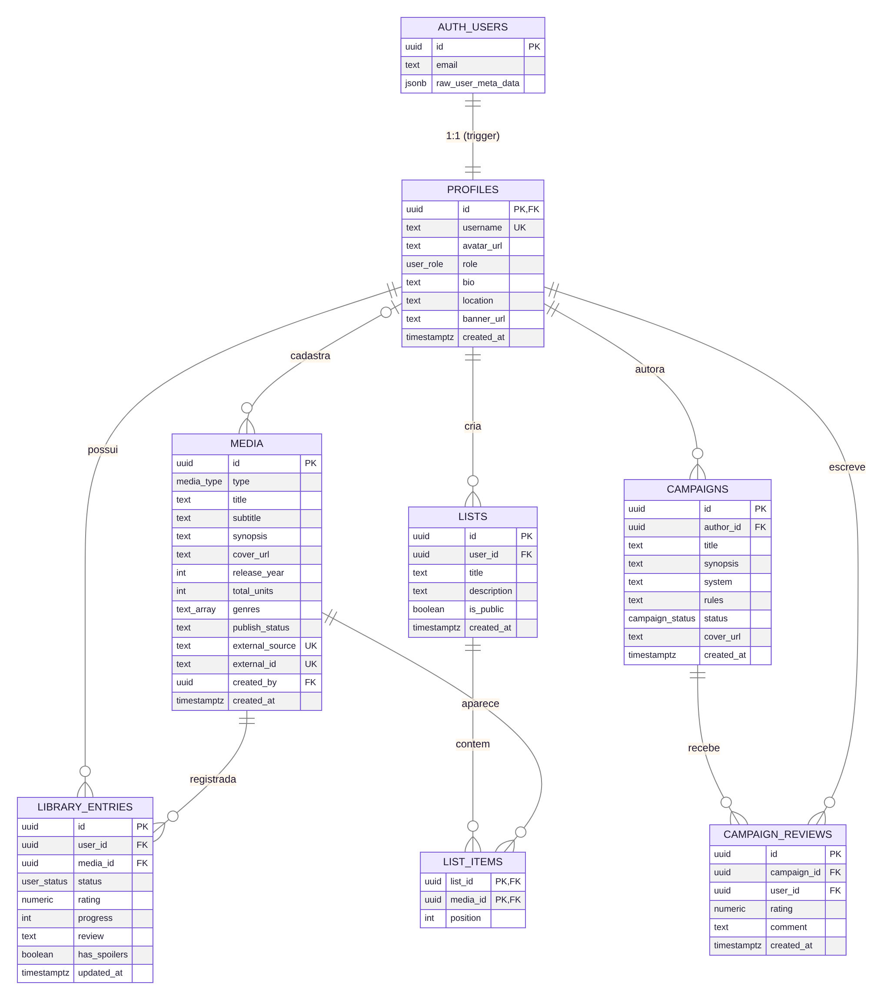

# Banco de Dados

| Tabela | Descrição |
| --- | --- |
| `profiles` | Perfil público (1:1 com `auth.users`), papel `user`/`admin` |
| `media` | Catálogo de obras |
| `library_entries` | Status, progresso, nota e resenha do usuário por obra |
| `lists` / `list_items` | Listas personalizadas |
| `campaigns` / `campaign_reviews` | Campanhas de RPG e avaliações |

## Regras importantes

- RLS em todas as tabelas: cada usuário só altera os próprios registros; admins moderam.
- Um registro por usuário e obra; uma avaliação por usuário e campanha.
- O perfil é criado automaticamente pelo trigger `on_auth_user_created`.

## Criando uma migração

1. Crie `supabase/migrations/NNN_descricao.sql` idempotente (`if not exists`).
2. Atualize o [dicionário de dados](https://github.com/LuisGlauser/RateMedia/blob/main/public/docs/md/06-modelo-de-dados.md) e o `der.mmd`.
