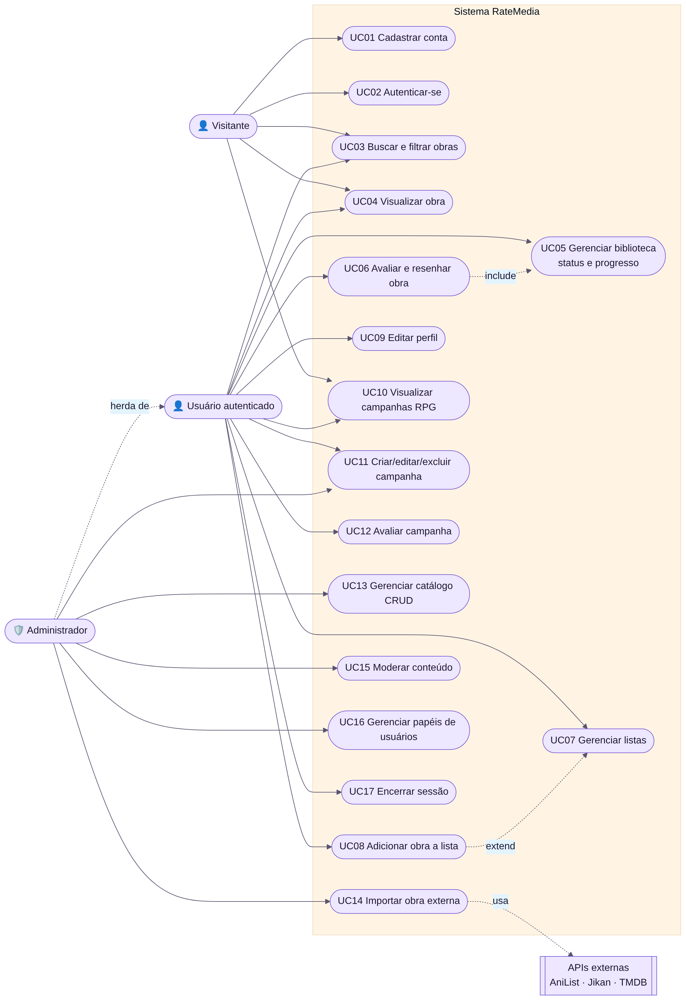

# Casos de Uso e Histórias

## Atores

- **Visitante:** navega, busca e vê obras e campanhas.
- **Usuário:** biblioteca, notas, resenhas, listas, perfil e campanhas.
- **Administrador:** catálogo, importação, moderação e papéis.

## Épicos

| Épico | Histórias |
| --- | --- |
| E1 Conta e acesso | US01–US03 |
| E2 Descoberta | US04–US06 |
| E3 Biblioteca e avaliações | US07–US11 |
| E4 Listas e perfil | US12–US14 |
| E5 Campanhas de RPG | US15–US18 |
| E6 Administração | US19–US23 |
| E7 DevOps e documentação | US24–US26 |

Especificação completa: [Casos de uso](https://github.com/LuisGlauser/RateMedia/blob/main/public/docs/md/03-casos-de-uso.md) · [Histórias de usuário](https://github.com/LuisGlauser/RateMedia/blob/main/public/docs/md/04-historias-de-usuario.md) · [Requisitos](https://github.com/LuisGlauser/RateMedia/blob/main/public/docs/md/02-requisitos.md).
