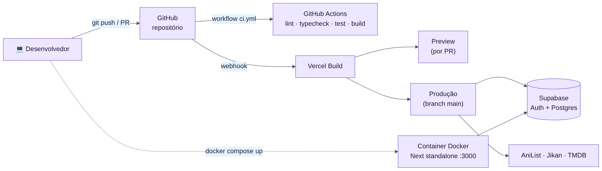

# Deploy e CI/CD

## GitHub Actions

`.github/workflows/ci.yml` roda em todo push e PR para `main` e `develop`. Os jobs rodam em paralelo:

| Job | O que faz |
| --- | --- |
| Lint e checagem de tipos | ESLint e `tsc --noEmit` |
| Testes unitários e de integração | Vitest, cada projeto no seu job |
| Build | Matriz: modo demonstração e com variáveis do Supabase |
| E2E | Playwright, depois das verificações rápidas |
| Performance | Perfis *smoke* e *load*, depois das verificações rápidas |
| Docker | Build da imagem e smoke test do contêiner |
| Segurança | gitleaks (segredos) e `npm audit` |
| **CI OK** | Consolida todos os jobs; é o check obrigatório da `main` |

Além disso, `codeql.yml` faz análise estática de segurança e `deploy.yml` testa as rotas principais do site depois de cada deploy. Detalhes dos testes em [[Testes]].

## Vercel

**Produção:** https://ratemedia.vercel.app

1. Importe o repositório em https://vercel.com/new (framework **Next.js**).
2. Em **Settings → Environment Variables**, cadastre `NEXT_PUBLIC_SUPABASE_URL`, `NEXT_PUBLIC_SUPABASE_ANON_KEY` e, se quiser, as variáveis do TMDB.
3. Cada PR gera um preview; o merge na `main` publica em produção.

## Versões e releases

- Versionamento semântico (`vMAJOR.MINOR.PATCH`).
- Atualize o [CHANGELOG](https://github.com/LuisGlauser/RateMedia/blob/main/CHANGELOG.md), crie a tag (`git tag -a v0.2.0 -m "v0.2.0"`) e publique a release no GitHub.

## Docker

Imagem multi-stage com Next.js `standalone`, usuário sem privilégios e *healthcheck*. Veja [DevOps](https://github.com/LuisGlauser/RateMedia/blob/main/public/docs/md/10-devops.md).
