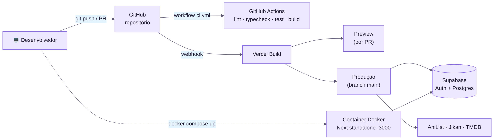

# Deploy e CI/CD

## GitHub Actions

`.github/workflows/ci.yml` roda em todo push e PR para a `main`, em três jobs:

1. **build-and-test:** lint, typecheck, testes unitários, testes de integração, build e `npm audit`.
2. **e2e** (depois do 1): instala o Chromium, faz o build em modo demonstração e roda o Playwright; o relatório fica nos *artifacts*.
3. **performance** (depois do 1, em paralelo): sobe o servidor e roda os perfis *smoke* e *load*; resultados nos *artifacts*.

Detalhes em [[Testes]].

## Vercel

**Produção:** https://ratemedia.vercel.app

1. Importe o repositório em https://vercel.com/new (framework **Next.js**).
2. Em **Settings → Environment Variables**, cadastre `NEXT_PUBLIC_SUPABASE_URL`, `NEXT_PUBLIC_SUPABASE_ANON_KEY` e, se quiser, as variáveis do TMDB.
3. Cada PR gera um preview; o merge na `main` publica em produção.

## Versões e releases

- Versionamento semântico (`vMAJOR.MINOR.PATCH`).
- Atualize o [CHANGELOG](https://github.com/LuisGlauser/RateMedia/blob/main/CHANGELOG.md), crie a tag (`git tag -a v0.2.0 -m "v0.2.0"`) e publique a release no GitHub.

## Docker

Imagem multi-stage com Next.js `standalone`, usuário sem privilégios e *healthcheck*. Veja [DevOps](https://github.com/LuisGlauser/RateMedia/blob/main/public/docs/md/10-devops.md).
